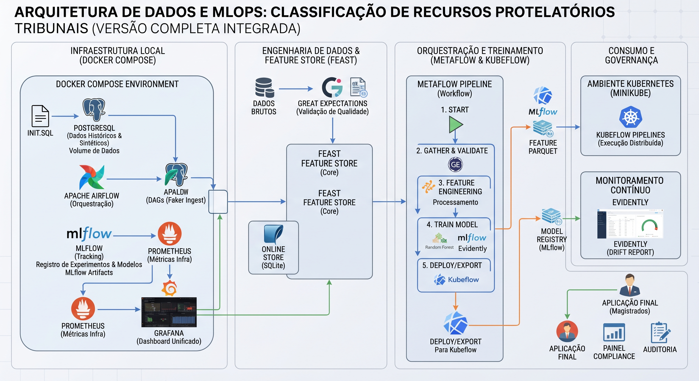

# Sistema MLOps de Classificação de Risco de Recurso Protelatório



Este repositório contém uma solução completa de Engenharia de Dados e MLOps desenvolvida para um tribunal com o objetivo de classificar processos judiciais em três categorias de risco de recurso protelatório (**baixo, médio e alto**), atendendo a rigorosos padrões de explicabilidade (XAI) e conformidade com a LGPD.

---

## 🛠️ Stack Tecnológica

- **Orquestração de Dados**: Apache Airflow & Metaflow
- **Orquestração de Pipelines (Kubernetes)**: Kubeflow Pipelines (KFP) via Metaflow
- **Armazenamento e Banco de Dados**: PostgreSQL
- **Feature Store**: Feast
- **Qualidade e Validação de Dados**: Great Expectations
- **Monitoramento e Data Drift**: Evidently AI
- **Rastreamento de Experimentos e Model Registry**: MLflow
- **Infraestrutura**: Docker & Docker Compose

---

## 📁 Estrutura da Raiz do Projeto

```text
meu_projeto_tribunal/
│
├── dags/
│   └── popular_processos_dag.py     # DAG do Airflow com geração sintética (Faker)
│
├── init/
│   └── init.sql                     # Script DDL de inicialização do PostgreSQL
│
├── data/
│   ├── processos_features.parquet   # Base processada para o Feast
│   ├── online_store.db              # SQLite do Feast
│   └── registry.pb                  # Registro de metadados do Feast
│
├── logs/                            # Logs de execução do Airflow
├── plugins/                         # Plugins do Airflow
│
├── docker-compose.yml               # Orquestração local (Postgres, MLflow, Airflow)
├── feature_store.yaml               # Configuração do Feast
├── pipeline_tribunal.py             # Pipeline principal (Metaflow + GE + Evidently + MLflow)
└── kubeflow.yaml                    # Rascunho de manifesto para Kubeflow
```

---

## 🚀 Como Executar o Projeto

### 1. Subir a Infraestrutura (Docker Compose)
Na raiz do projeto, execute o comando abaixo para iniciar o PostgreSQL, MLflow e o Airflow:
```bash
docker-compose up -d
```

### 2. Acessar os Serviços
- **Airflow UI**: [http://localhost:8080](http://localhost:8080) (Usuário: `admin`, Senha: `admin`)
- **MLflow UI**: [http://localhost:5001](http://localhost:5001)
- **PostgreSQL**: Porta `5432`

### 3. Popular a Base de Dados via Airflow
No painel do Airflow, localize a DAG `popular_processos_faker_dag`, ative-a e clique em **Trigger DAG** para gerar e inserir os dados sintéticos com o `Faker` na tabela `processos_juridicos`.

### 4. Executar o Pipeline de ML / MLOps (Metaflow)
Certifique-se de que o arquivo de configuração do Feast (`feature_store.yaml`) está na raiz e execute o fluxo de treinamento, engenharia de features e validações:
```bash
python pipeline_tribunal.py run
```

### 5. Kubeflow Pipelines
O fluxo atual usa Metaflow, que não oferece o subcomando `kubeflow create` usado anteriormente. O arquivo `kubeflow.yaml` é apenas um rascunho; a compilação e execução como Kubeflow Pipeline ainda não estão implementadas.

---

## 🔒 Conformidade com a LGPD e Governança
- **Minimização de Dados**: O pipeline remove ou anonimiza dados de identificação direta (`cpf_autor`, `nome_autor`) antes do treinamento para evitar vieses discriminatórios.
- **Explainability (XAI)**: O modelo suporta ferramentas como LIME, SHAP, Feature Importance e Regras Extraídas para garantir total transparência aos magistrados.